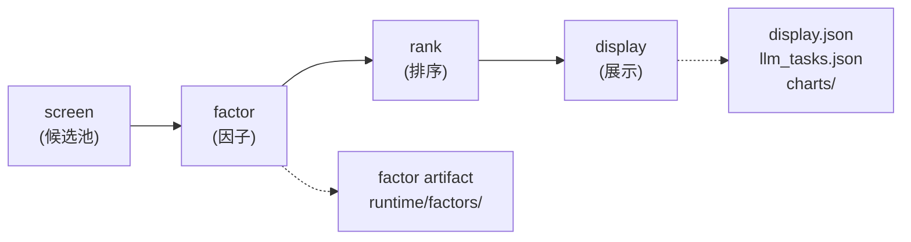
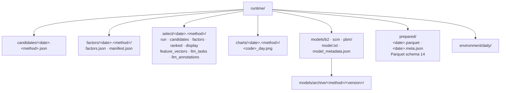
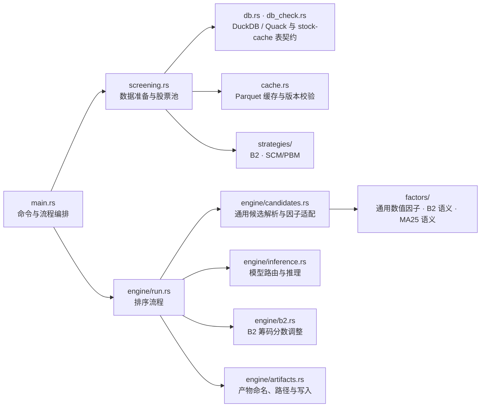

# stock-select CLI 架构

## 总览

`stock-select-rs` 是一个 Rust CLI 工具，用于 A 股选股筛选、排序和复盘。核心流程是 **screen → factor → rank → display**，以 LightGBM 模型排序为主路径。



## 二进制

```text
binary: stock-select-rs
source: src/main.rs
```

编译后安装在 `~/.cargo/bin/stock-select-rs`。

## 子命令

| 命令 | 功能 |
|------|------|
| `screen` | 筛选候选股，可选导出因子 |
| `run` | 完整流水线：screen → factor → rank → chart → review task |
| `review` | 从已有 display 生成 LLM task |
| `review-list` | 查看排序结果 |
| `review-merge` | 合并人工/LLM 复盘 annotation |
| `chart` | 生成 K 线图表 |
| `completions` | shell 补全 |

### screen

```bash
stock-select-rs screen --method b2 --pick-date 2026-06-05
stock-select-rs screen --method b2 --pick-date 2026-06-05 --export-factors
```

- 从 `DUCKDB_PATH` 指向的本地 DuckDB 文件或 Quack 服务获取 stock-cache 行情数据
- 计算技术指标（均线、MACD、量价等）
- 按选股规则筛选候选股
- 写入 `runtime/candidates/<date>.<method>.json`
- `--export-factors` 额外导出因子到 `runtime/factors/`

当前所有入口仅支持 `b2`、`scm`、`pbm`；旧策略及历史产物兼容代码已删除。各方法的股票池过滤和策略条件见 [选股筛选方法过滤条件](screening-methods.md)。SCM 与 PBM 使用独立模型目录。

### run

```bash
stock-select-rs run --method b2 --pick-date 2026-06-05
stock-select-rs run --method b2 --llm-review-limit 5 --pick-date 2026-06-05
```

完整流水线：
1. **auto-screen** — 内部调用 screen（`export_factors: false`）
2. **环境评分** — 用上证指数/国证 2000 评估市场状态（weak / neutral / strong）
3. **selection**：
   - 加载候选 → 注入 prepared history → 计算因子 → 模型推理 → 排序 → 写 display artifact
4. **chart** — 为 top N 候选生成 K 线 PNG
5. **review task** — 生成 LLM 复盘任务文件

输出到 `runtime/select/<date>.<method>/`：
- `run.json` — 运行元信息
- `candidates.json` — 候选列表
- `factors.json` — 因子矩阵
- `ranked.json` — 排序结果
- `display.json` — 展示行（含 model_rank, model_score, llm_action 等）
- `feature_vectors.json` — 特征向量（用于调试）
- `llm_tasks.json` — LLM 复盘任务
- `llm_annotations.json` — 子代理/人工复盘 annotation
- `llm_report.html` — `review-merge` 生成的图文复盘报告
- `llm_raw/<code>.json` — 单票子代理原始复盘内容

### review-list

```bash
stock-select-rs review-list --method b2 --pick-date 2026-06-05 --limit 20
```

输出格式（tab 分隔）：

```text
rank  code    name    industry  score       bias  action  flags
1     000001  平安银行  银行       0.700000    ↑     KEEP    -
```

- `rank` — 模型排序位置（1-based）
- `score` — LightGBM 原始预测分
- `bias` — LLM 短线符号：`↑` 看多、`→` 谨慎、`↓` 看空、`-` 未复盘
- `action` — LLM 复盘动作
- `flags` — LLM 风险标记

### review / review-merge

```bash
stock-select-rs review --method b2 --pick-date 2026-06-05 --limit 5
stock-select-rs review-merge --method b2 --pick-date 2026-06-05
```

- `review` 从 `display.json` 生成 `llm_tasks.json`，包含 `chart_path`、建议的 `raw_response_path`、`llm_report_path` 和游资/短线读图提示
- `review-merge` 将填写的 `llm_annotations.json` 合并回 display，并生成 `llm_report.html`

### chart

```bash
stock-select-rs chart --method b2 --pick-date 2026-06-05 --chart-workers 4
```

生成 K 线图（含 MA25、中道/中轨、MACD、成交量）到 `runtime/charts/<date>.<method>/`。

### 通用参数

| 参数 | 说明 |
|------|------|
| `--method` | 筛选方法，当前 `screen` 支持 `b2` / `scm` / `pbm`，默认 `b2` |
| `--pick-date` | 交易日（默认取当前日期） |
| `--intraday` | 盘中模式 |
| `--runtime-root` | runtime 根目录（默认 `~/.agents/skills/stock-select/runtime`） |
| `--dsn` | DuckDB 文件路径或 Quack URI；默认读取 `DUCKDB_PATH` |
| `--pool-source` | 候选池来源（`turnover-top` 等） |
| `--pool-file` | 自定义股票池文件 |

## 配置优先级

```text
CLI 参数  >  shell 环境变量  >  当前目录 .env
```

关键环境变量：

| 变量 | 说明 |
|------|------|
| `STOCK_SELECT_RUNTIME_ROOT` | runtime 根目录 |
| `DUCKDB_PATH` | stock-cache DuckDB 文件路径或 Quack URI |
| `QUACK_AUTH_TOKEN` | Quack 认证 token |
| `QUACK_SSL_FINGERPRINT` | Quack TLS 服务端指纹，可选 |
| `TUSHARE_TOKEN` | Tushare API token |
| `STOCK_SELECT_PREPARED_CACHE_LIMIT` | EOD prepared cache 最多保留数量，默认 30；盘中 cache 不计入 |
| `STOCK_SELECT_RECORD_LIMIT` | 每次 `update_run_record` 最多写入排名前 N 条，默认 30 |
| `STOCK_SELECT_BIN` | 二进制路径（用于脚本） |

## Runtime 目录布局



# 运行时架构全图

```mermaid
flowchart TD
    subgraph CLI["CLI Entry (src/main.rs)"]
        CMD["Commands"]
        CMD --> SCREEN["screen"]
        CMD --> RUN["run<br/>(全流水线)"]
        CMD --> REVIEW["review"]
        CMD --> RL["review-list"]
        CMD --> RM["review-merge"]
        CMD --> CHART["chart"]
        CMD --> CI["clean-intraday"]
    end

    %% ── screen 子命令 ──
    SCREEN --> SCR["run_db_native_screen_with_loader()<br/>src/screening.rs"]
    SCR --> POOL{"pool_source"}
    POOL -->|turnover-top| TOP["fetch turnover_top N<br/>from stock-cache DuckDB"]
    POOL -->|custom| POOLF["读取 pool_file"]
    TOP --> WINDOW["fetch_db_native_daily_window()<br/>stock-cache DB-native<br/>约 252 个交易日窗口<br/>src/db.rs"]
    POOLF --> WINDOW
    WINDOW --> LOCAL["enrich_local_market_factors()<br/>boll_width / bias / roc / mtm / psy / wr"]
    LOCAL --> IND["映射 DB 指标并补必要本地序列<br/>KDJ / MACD / rolling / CZSC / ZX"]
    IND --> PREP["write_prepared_cache()<br/>Parquet schema 14<br/>→ runtime/prepared/*.parquet"]
    PREP --> STRAT{"策略筛选"}
    STRAT -->|b2| B2STRAT["run_b2_strategy_from_refs()<br/>src/strategies/b2.rs"]
    STRAT -->|scm| SCMSTRAT["run_scm_strategy_from_refs()<br/>src/strategies/scm_pbm.rs"]
    STRAT -->|pbm| PBMSTRAT["run_pbm_strategy_from_refs()<br/>src/strategies/scm_pbm.rs"]
    B2STRAT --> CAND["candidates JSON<br/>→ runtime/candidates/"]
    SCMSTRAT --> CAND
    PBMSTRAT --> CAND
    CAND --> EXP{"--export-factors"}
    EXP -->|yes| EFACT["build_candidate_factor_rows_from_refs()<br/>→ runtime/factors/"]
    EXP -->|no| SDONE["screen 完成"]

    %% ── intraday 路径 ──
    SCREEN -.->|intraday| RT["TushareRestProvider<br/>fetch_rt_k() 实时快照<br/>src/intraday.rs"]
    RT --> IWINDOW["build_intraday_market_rows_with_macd_states()<br/>实时日/周/月 MACD"]
    IWINDOW -.-> PREP

    %% ── run 全流水线 ──
    RUN --> RPICK["resolve_pick_date()"]
    RPICK --> ASCREEN["auto-screen<br/>ScreenRequest{export_factors:false}"]
    ASCREEN --> CAND
    ASCREEN --> ENV["resolve_command_environment()<br/>src/environment.rs"]
    ENV --> ENVEVAL{"手动指定?"}
    ENVEVAL -->|manual_state| MREC["upsert manual EnvironmentRecord"]
    ENVEVAL -->|自动| EVAL["ensure_market_environment()<br/>上证/国证2000 评分<br/>→ weak / neutral / strong"]
    EVAL --> PERSIST["persist → runtime/environment/daily/"]
    MREC --> ENVDONE["ResolvedEnvironment"]
    PERSIST --> ENVDONE

    ENVDONE --> SEL["run_selection()<br/>src/engine/run.rs"]

    subgraph SELECTION["Selection Engine"]
        SEL --> MART["resolve_method_model_artifacts()<br/>→ runtime/models/{method}/"]
        MART --> LOADM["load_model()<br/>LightGbmRuntimeModel<br/>src/engine/inference.rs"]
        LOADM --> RCAND["read_candidates()"]
        RCAND --> INJENV["inject_environment_factor()"]
        INJENV --> INJPREP["inject_prepared_history()"]
        INJPREP --> PCACHE["load factor_rows from<br/>prepared cache 或<br/>recompute"]
        PCACHE --> FACTROW["FactorRow 计算<br/>src/factors/registry.rs"]

        subgraph FACTORS["Factor Registry"]
            FACTROW --> BUNDLE{"method → FactorBundle"}
            BUNDLE -->|b2| B2F["RawCommon + B2Semantic"]
            BUNDLE -->|scm / pbm| MA25F["RawCommon + Ma25Semantic"]
            B2F --> COMMON["RawCommon 因子<br/>macd / ma_support / volume_turnover<br/>price_position / bar_shape<br/>range_compression / zx_pullback<br/>abnormal_volume"]
            B2F --> B2SEM["B2Semantic<br/>语义因子"]
            MA25F --> COMMON
            MA25F --> MA25SEM["Ma25Semantic<br/>语义因子"]
        end

        FACTROW --> WRFACT["write_factor_artifact()<br/>→ runtime/select/.../factors.json"]
        WRFACT --> RANK["rank_candidates()"]
        RANK --> FVEC["build_feature_vector()<br/>按 model_metadata 特征顺序"]
        FVEC --> PRED["LightGbmRuntimeModel.predict()<br/>num_threads=1"]
        PRED --> SORT["sort by model_score ↓ → assign model_rank"]
        SORT --> DROW["display_rows()<br/>merge name/industry"]
    end

    DROW --> WART["write artifacts<br/>run.json / candidates.json<br/>factors.json / ranked.json<br/>display.json / feature_vectors.json"]

    WART --> CHARTBLK["write_chart_artifacts()"]
    CHARTBLK --> CHIST["load_chart_histories()<br/>从 prepared cache 取日线"]
    CHIST --> CPAYLOAD["write_chart_payloads()<br/>分批 JSON payload"]
    CPAYLOAD --> CREND["run_chart_renderers()<br/>uv run scripts/render_charts.py<br/>→ runtime/charts/{date}.{method}/"]

    CREND --> REVBLK["write_review_task_artifacts()"]
    REVBLK --> LLMT["→ llm_tasks.json<br/>含 chart_path / 复盘提示"]

    %% ── LLM 复盘回路 ──
    LLMT -.-> SUBAGENT["子代理复盘<br/>逐票填 annotation"]
    SUBAGENT -.-> LLMANN["→ llm_annotations.json"]
    LLMANN -.-> RMERGE["review-merge"]
    RMERGE -.-> HTML["生成 llm_report.html<br/>图文复盘报告"]

    %% ── Styles ──
    style CLI fill:#1a1a2e,stroke:#16213e,color:#eee
    style SELECTION fill:#0f3460,stroke:#16213e,color:#eee
    style FACTORS fill:#16213e,stroke:#0f3460,color:#eee
```



## 数据流

```mermaid
flowchart LR
    DB[("DuckDB file or Quack<br/>duckdb-neo, read-only")] --> SC["screening"]
    SC --> CJ["candidates JSON"]

    CJ --> CPI["inject prepared history"]
    CPI --> FP["CandidatePayload<br/>FactorProvider"]
    FP --> FR["FactorRow<br/>(技术指标 + 量价因子)"]

    FR --> BF["build_feature_vector"]
    BF --> LGB["LightGBM predict"]
    LGB --> MS["model_score (f64)"]

    MS --> SORT["sort by score ↓"]
    SORT --> RC["RankedCandidate<br/>model_rank (usize)"]

    RC --> MERGE["merge name / industry"]
    MERGE --> DR["DisplayRow"]
    DR --> RL["display.json<br/>→ review-list"]
```




## 源码职责与目录整理

当前保留 `strategies/b2.rs` 和 `strategies/scm_pbm.rs`；后者共享 MA25 形态计算，分别输出 SCM、PBM。删除旧策略模块及专用字段，避免在共享流程中继续维护无效分支。



本轮将三种策略共用的候选适配从 `engine/b2.rs` 移到 `engine/candidates.rs`，接口改为 `CandidateFactorProvider`；产物日期命名归入 `engine/artifacts.rs`，B2 专属筹码调整留在 `engine/b2.rs`。

下一步整理优先级：

1. `main.rs` 同时包含参数定义、命令编排、图表调用和 HTML 报告；可按实际职责拆入 `cli/`，保持库入口不变。
2. `db.rs` 可在下次修改数据源时，把连接及参数绑定放入私有子模块，把 stock-cache 行情映射留在加载模块。调用方继续使用现有加载函数。
3. `cache.rs` 的 Parquet 编解码可在增加新缓存类型时放入私有子模块；`factors/registry.rs` 可在增加新因子族时拆出数据库字段映射。两者当前接口集中，不宜仅按文件行数拆成大量转发模块。

## 当前产物契约

- prepared 缓存只使用 Parquet schema 14，显式声明共享消费者和计算版本；缺失或版本不符时重建。
- 候选输入必须包含 `method`、`pick_date`、`candidates`，策略和日期必须与请求一致；不接受裸数组或 `rows` 候选结构。
- 因子产物使用 `rust-factor-library-v5`；SCM/PBM 的共用语义因子统一为 `ma25_*`，不读取旧前缀。
- 模型元数据必须明确声明类别编码；归档只读取 `models/archive/<method>/<version>/`。旧数据集、候选、因子和模型应按当前流程重新生成。

## 因子计算与 Polars

当前因子热路径是 Rust `Vec` 数值循环、MACD 状态机、CZSC 结构及按股票的历史窗口计算。数据加载和批量关联已交给 DuckDB；缓存读写使用 Arrow/Parquet。仅在入口把数据换成 Polars，不会自动加速有状态的 MACD/CZSC 算法，还会增加数据转换和编译依赖。

Polars 适合批量 rolling、分组聚合、横截面排名，以及 Python 数据集中的 join 和列运算。后续若剖析表明这些步骤占主耗时，可选一个热点比较 DuckDB SQL、现有 Rust 实现和 Polars lazy 表达式的完整耗时与峰值内存，包含格式转换成本。本轮未引入 Polars，未做 Polars 性能基准，不给出加速倍数。
