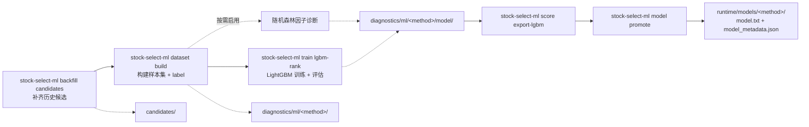
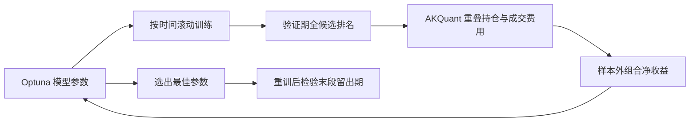

# 模型系统

## 总览

当前生产主路径是 LightGBM 排序：模型输出候选股顺序，`model_rank` 和 `model_score` 决定最终展示顺序。LLM/人工复盘只做 annotation（风险标记、备注），不改 rank。

训练、导出、发布和回滚统一通过 `stock-select-ml` Python CLI 按 `--method` 维护产物，仅支持 `b2`、`scm`、`pbm`。三种方法分别构建数据集、训练和发布，模型目录互相独立；生产 `run/review` 由 Rust 执行推理。

截至 2026-11-24，SCM 的 EOD 模型已发布，版本 `20261123T114344Z`，训练窗为 2023-02-01 至 2026-09-23，评分窗为 2026-10-08 至 2026-10-21，使用 `rank_label_exit` 和 14 折滚动验证。该模型有 2,523 个特征。绑定其模型 SHA256 的开仓策略阈值为原分 `-0.17610267956906622`、Top3，校准结束日为 2026-11-20；策略状态仍是 `research`，只对校准结束日之后的 EOD 运行适用。SCM 盘中模型尚未发布。当前状态应以 `stock-select-ml model status --method scm` 和模型 metadata 为准。



## 训练流程

### 1. 补齐历史候选

训练窗口由本次实验目标确定，开始前显式设置，结束后以模型 metadata 中记录的实际日期为准。补数据并发和模型线程数最多为 8；训练默认 8 线程。

```bash
METHOD=b2

uv run stock-select-ml backfill candidates \
  --method "$METHOD" \
  --start-date <TRAIN_START> \
  --end-date <TRAIN_END> \
  --workers 8
```

- 从 DB 读取每日行情
- 运行 screen 逻辑生成历史候选
- 写入 `runtime/candidates/<date>.<method>.json`

### 2. 构建训练集

```bash
uv run stock-select-ml dataset build \
  --method "$METHOD" \
  --runtime-root runtime \
  --source candidates \
  --start-date <TRAIN_START> \
  --end-date <TRAIN_END>
```

- 加载候选 → 按 code+date 关联因子
- 从 DB 获取未来收益作为 label，口径与 AKQuant 成交对齐：信号日 `t` 收盘后排名，`t+1` 开盘买入，持有 `H` 个交易日后在 `t+H+1` 开盘卖出，因此 `retH = open_qfq(t+H+1) / open_qfq(t+1) - 1`。例如 Top3 持有 3 日的回测收益对应 `ret3`。
- `ret3/ret5/ret10` 都按上述买入和退出时点计算；`max_drawdown_5d` 用买入日起 5 个交易日的 qfq 最低价相对买入开盘价计算。标签记录毛收益，佣金、税费和整手成交由 AKQuant 回测处理。
- `stock_stk_factor_pro` 的标签行情使用 `open_qfq` / `low_qfq`，读取时显式标记 `price_basis=qfq`，直接按同基准价格计算收益和最低价回撤，不再乘一次 `adj_factor`。标签输入必须明确标记 `price_basis=qfq`，未标记、原始行情或混用价格基准均报错。修正此口径后必须重建 dataset 和日内分档标签，旧报告的收益统计不能直接沿用。
- 每个交易日独立排序，生成分档标签。当前实现按收益升序索引计算 `floor(index * 3 / (count - 1))`，不等同于严格四分位；例如 20 只股票的 0/1/2/3 档数量为 7/6/6/1。最高档通常仅覆盖当日收益第一名。此口径与原先四等分说明存在差异，下一轮标签实验应优先修正或明确设计意图。

| label | 当前分档 | 含义 |
|-------|----------|------|
| 3 | 最高一名（多股票日） | 相应期限收益最高 |
| 2 | 最高一名以下的上段 | |
| 1 | 中段 | |
| 0 | 下段 | |

- 输出 CSV 到 `diagnostics/ml/<method>/rank_dataset.csv`

### 3. 训练

```bash
uv run stock-select-ml train lgbm-rank \
  --method "$METHOD" \
  --dataset "diagnostics/ml/$METHOD/rank_dataset.csv" \
  --output-dir "diagnostics/ml/$METHOD/model" \
  --feature-set raw_numeric \
  --num-leaves 9 \
  --min-data-in-leaf 120 \
  --num-boost-round 60 \
  --learning-rate 0.05 \
  --num-threads 8 \
  --rolling-folds 5 \
  --rolling-train-dates 120 \
  --rolling-test-dates 20 \
  --skip-rf-diagnostics
```

训练和验证按日期切分，并按标签的完整前视窗口隔离：三日标签为 4 个日期，五日为 6，十日为 11。单次切分从训练集尾部剔除这些日期；滚动切分保留指定训练日期数，在训练和验证之间额外留出隔离日期。训练报告记录 `purge_gap`；OOF 导出同样使用隔离窗口，多模型组合取最长标签窗口。

只有各折验证期的预测可作为回测信号，不能将最终模型对自身训练期的打分用于历史回测。标签表示单只股票按约定买卖时点计算的毛收益；AKQuant 再模拟资金、重叠持仓、成交约束和费用，得到组合净收益。

随机森林因子诊断是可选步骤。常规训练传 `--skip-rf-diagnostics`；只有用户明确要求 RF 诊断、门禁或因子筛选时才启用。启用时，它使用同一份特征选择、one-hot 编码、时间切分和 label 口径，诊断产物写入同一输出目录：

```text
diagnostics/ml/<method>/model/rf_feature_diagnostics.json
diagnostics/ml/<method>/model/rf_feature_diagnostics.md
```

LightGBM report 的 `rf_diagnostics` 字段会嵌入随机森林摘要，包括诊断状态、OOB、测试集 RankIC、Top features 和低重要性因子数量。随机森林不进入 Rust 生产推理，也不作为默认的训练门禁。

如果需要让 RF 层实际承担筛选职责，训练时显式传 `--rf-feature-selection cumulative_importance`，并用 `--rf-cumulative-importance-threshold` 和 `--rf-min-selected-features` 控制累计重要性阈值与最小保留数量。开启后，RF 先在候选特征上计算完整重要性，类别 one-hot 重要性会聚合回原始类别列；随后 LightGBM 最终模型、rolling validation、`feature_manifest.json` 和 `model_metadata.json` 都只使用 RF 选中的特征。`rf_feature_diagnostics.json` 会保留完整 `feature_importances`，`top_features` 只作为展示截断列表。

### 3.1 Optuna 调参可视化

`stock-select-ml tune lgbm-rank --strategy optuna` 默认只写 `tuning_summary.json`。需要查看 trial 目标值变化、参数重要性和关键参数分布时，增加 `--visualize`：

```bash
uv run stock-select-ml tune lgbm-rank \
  --method "$METHOD" \
  --dataset "diagnostics/ml/$METHOD/rank_dataset.csv" \
  --output-root "diagnostics/ml/$METHOD/tuning" \
  --strategy optuna \
  --max-trials 24 \
  --visualize
```

默认输出到 `diagnostics/ml/$METHOD/tuning/visualizations/`，可用 `--visual-output-dir <DIR>` 改写目录；当前 `--visual-format` 只支持 `html`。产物包括 `optimization_history.html`、`param_importances.html`、`slice.html`，参数数量足够时还会生成 `parallel_coordinate.html`。`visualizations_summary.json` 记录 `files`、`trial_count`、`best_trial`、`best_value`、`target_metric` 和 `warnings`；单个图生成失败只写入 warning，不会让已完成的调参结果失败。若可视化目录创建或 `visualizations_summary.json` 写入失败，主 `tuning_summary.json` 仍会落盘，并在主 summary 的 `warnings` 中记录失败原因。

### 3.2 以 AKQuant 组合净收益调参

`--objective akquant --strategy optuna` 将滚动样本外排名送入 AKQuant，把扣费后的组合 `total_return_pct` 返回给 Optuna。标签负责训练排序模型，AKQuant 组合收益负责选参数；RankIC 和 Top3 胜率作为诊断记录。原有 `default` 等目标仍按标签指标评分。



```bash
uv run --extra tuning --extra backtest stock-select-ml tune lgbm-rank \
  --method scm \
  --dataset diagnostics/ml/scm/2026-baseline/rank_dataset.csv \
  --market-data diagnostics/ml/scm/2026-optuna-akquant/market_qfq.parquet \
  --output-root diagnostics/ml/scm/2026-optuna-akquant/final-run \
  --strategy optuna --objective akquant \
  --top-n 3 --holding-days 3 --capital-allocation 0.9 \
  --holdout-dates 40 \
  --rolling-folds 3 --rolling-train-dates 100 --rolling-test-dates 20 \
  --max-trials 12 --patience 4 --num-threads 8 --skip-rf-diagnostics
```

该目标固定与持有期匹配的 `rank_label_3d/5d/10d`、全部 method 适用特征、one-hot 编码和零 early stopping，搜索模型容量、轮数和正则参数。可选全空特征只根据首折训练数据剔除；各折类别水平只从训练数据生成。RF 不参与此路径。

日期先预留完整退出行情，再划出末段留出期；训练与验证之间隔离 `holding_days + 1` 个日期，并按个股实际标签结束日额外剔除前视样本、重建日内分档。标签在此目标内按全市场交易日重算：下一交易日开盘买入，到期退出日若无 K 线，则延至首个可交易开盘。预测保留无未来标签的候选，不能根据未来行情完整程度删股。停牌退出仅由执行层模拟等待复牌；AKQuant 日线报告时间戳为该日 bar 时间，成交价格使用对应开盘价。

每日 TopN 为独立批次，每批持有 N 日，允许同股跨日重复入选和持仓重叠。每日预算为权益乘 `capital_allocation / holding_days`，同时受现金加当批预计卖出所得的上限约束，并预留 `1 - capital_allocation` 的缓冲；不能预支仍停牌持仓的价值。该缓冲不保证任意跳空下都能成交，拒单仍会使实验失败。默认佣金万三、最低 5 元、卖出印花税万五、过户费十万分之一、100 股整手、T+1。使用 qfq 行情时，整手数量与绝对费用近似于真实名义成交；当前未模拟涨跌停排队、滑点与不同板块特殊最小买入量。

产物包含 `split.json`、逐 trial 的 `signals.csv/backtest.json/evaluation.json`、`selection.json`、`tuning_summary.json`，以及 `holdout_model/` 的模型、特征清单、留出信号和报告。`selection.json` 在评估留出期前写出；最后模型只使用开发区间训练，不读取留出期标签选择参数。报告的 `rolling_summary` 来自开发区间 OOF，`metrics.test` 来自末段留出期。结构 dry-run 通过不代表收益达标，不自动发布。

### 3.3 按交易规则退出的排序标签

在上述 AKQuant 调参命令追加 `--exit-policy <退出规则.json>`，目标自动切换为 `rank_label_exit`。普通 `train lgbm-rank` 的固定期限路径不用于这个标签，避免绕过实际退出日隔离。每日仍选 Top3、同股跨日独立建批；退出不再固定为三天。以下 JSON 是当前可配置占位，四项退出条件之间为“或”：

```json
{"volume_lookback":5,"volume_multiple":1.5,"timeout_days":3,"timeout_return_pct":3.0}
```

| 退出条件 | 当前口径 |
| --- | --- |
| MA25 止损 | 可卖日起，收盘价严格低于当日 MA25 |
| 放量阳线半线 | 从买入日起，收阳、收盘高于前收、成交量至少为此前 5 根日线均量的 1.5 倍；保存最近一根实体中点，后续收盘严格跌破时退出 |
| T+3 涨幅不足 | 买入日记为 T，T+3 当天收盘相对实际买入价涨幅严格小于 3%；此前曾达到 3% 仍退出，当天恰好达到 3% 则通过，之后不重复检查这项超时条件 |
| 通达信条件 | `CROSS(D,K) AND D>65 AND J1<MJ1 AND COUNT(J1>1,3)>=1`，KDJ 使用 `(5,2,3)`；`J1=(MA20/REF(MA20,1)-1)*100`，`MJ1=MA(J1,3)` |

信号日收盘排名，下一交易日开盘买入。使用日线收盘近似尾盘卖出，遵守 T+1；买入日只更新放量阳线状态，可卖日起才判断退出。KDJ 使用通达信 SMA 递推及首值初始化，与选股侧默认参数的 KDJ 分开计算。交易日按全市场日历计数；T+3 停牌时在复牌首个收盘补检，期间不虚构价格或成交。

若入选股票在下一交易日没有行情，保留原入选排名并记录 `unfilled_entries`，该买单不延至复牌日买入，也不以其他候选补位。标签对应 `untradable_entry`，收益保持缺失；组合回测保留未成交订单和闲置现金。资金不足及其他非预期拒单仍会中止实验。

`ExitState` 为标签和 AKQuant 执行共用的退出状态机。`exit_return` 是实际退出价相对买入开盘价的毛收益百分比；`exit_net_return` 计入比例佣金、卖出印花税与过户费，再按同日收益四分位生成 0/1/2/3 档。20 个不同收益对应 5/5/5/5，同收益使用相同档位；旧固定期限标签及历史实验的 7/6/6/1 分档保持原口径。标签不含依赖成交金额的最低佣金，最低佣金、整手股数、重叠持仓和现金约束由 AKQuant 计算。

训练只使用实际退出日严格早于预测起始日的样本，并用当时已完成的同日样本重建分档；固定 4 日隔离之外，长持仓也会被额外剔除。预测候选只检查信号当日历史是否足够，不按未来标签是否完整删股。未触发退出的样本记录 `right_censored`，收益及档位留空；回测末日保留持仓市值，不强制平仓。仅使用当年行情时，MA25 历史不足的年初样本不参与本目标。

规则配置属于交易策略；模型只学习该策略收益的排序，不输出买卖指令。Optuna 仍以开发期 OOF 的组合净收益选择模型参数；`policy_dataset.csv`、`label_summary.json` 和模型元数据保存目标与退出配置，诊断使用 `top3_exit_net_return_*` 和 `rank_ic_exit_net_return`。开发期估值在留出期开始前结束，避免用留出行情选择参数。比较 60/80/100 日训练窗口时，使用 `anchored_training_windows` 保持完全相同的 OOF 日期；最终留出模型为所选窗口训练的一支静态模型。

### 3.4 连续规则收益回归

在 `tune lgbm-rank --strategy optuna --objective akquant --exit-policy <JSON>` 中追加 `--learning-task return-regression`，训练目标改为连续的 `exit_net_return`。默认 `--learning-task rank` 仍学习四档标签。回归保留负数及小数，例如 `-2.75` 表示扣除比例费用后亏损 2.75%；不做收益分档，不向 LightGBM 传入排序分组、`label_gain` 或截断参数。

Optuna 同时搜索 `regression`（L2）与 `regression_l1`（L1）损失及模型参数，最终仍以相同开发期 OOF 的 AKQuant 组合净收益选优。L2 倾向条件均值，L1 倾向条件中位数，输出分数的单位为收益百分点；未经校准检验，不能把分数直接视为可靠的预期收益或仓位指令。每日依旧按分数降序选 TopN，不自动增加开仓阈值或空仓日。

连续目标沿用实际退出日隔离、未退出标签留空、预测不依赖未来标签、T+1 和比例费用等口径。元数据的 `training_target` 记录退出配置、损失和分数单位。该路径直接导出已训练模型及留出信号，不再运行会重新训练的通用 `score export-lgbm`。模型研究应固定特征、训练窗口、OOF 日期、资金规则和退出规则，以区分目标改变带来的效果；已观察过的留出期只能作为探索性检验。

### 3.5 跨季度分布验证

AKQuant 目标可指定 `--validation-scheme quarter-blocks --initial-train-dates 120 --rolling-test-dates 20 --holdout-dates 10 --seed <固定种子>`。训练热身后，每季度随机抽取一个连续选参窗口和一个连续最终留出窗口，两段间至少隔离 `holding_days + 1` 个日期；不足完整窗口的季度保留完整留出段并缩短选参段，最少 5 日，仍不足则记录跳过。按日期分组，同日股票不拆开；不随机打散股票行。

各折累计使用测试开始前的历史，并剔除所有最终留出日期及其前后隔离区间，以及标签持有区间经过留出日期的样本。模型只能使用预测时已经结束的标签；类别水平和可选特征覆盖仍只从训练数据确定。Optuna 仅用选参窗口的组合净收益，选好参数后才运行全部留出折及基线对照。`split.json` 保存随机种子、全部窗口和各折日期；报告同时保存逐折结果与全部留出预测的汇总指标。

此方案留出的是开仓信号日期，持仓按原规则跨越窗口空档直至退出，行情估值统一到可用末日，不在窗口末强平。选参交易的退出可能经过留出信号日，因此不能把完整行情路径称为封闭盲测。已研究过的历史只作探索性检验。季度采用不同信号频率，组合累计收益不与连续每日交易实验直接比较；同时检查逐季度、逐行情阶段的胜率和收益，避免好环境掩盖弱环境。

`holdout_model/` 导出最后一个留出折的模型，训练与评分范围以 metadata 为准；跨季度汇总回测由多支历史模型组成，不代表一支最终静态模型的全历史表现。发布前仍需单独判断，并执行 dry-run。

### SCM 原始分数开仓分档

SCM 可在模型元数据中保存 `score_entry_policy`，将开仓门槛与 `model.txt` 的 SHA256、校准结束日、盘后模式绑定。生产 `model_score` 是当日名次归一化分数，不能用于绝对门槛；新增的 `raw_model_score` 保存真实 LightGBM 输出。分数表示相对排序能力，不解释为盈利概率。

2026-11-23 发布的 SCM 模型绑定策略使用原分 `-0.17610267956906622` 和 Top3：原分低于门槛时为“丢弃”，达到门槛且在 Top3 为“开仓”，达到门槛但超出 Top3 为“观察”。开仓与丢弃线相同，没有额外的观察分数区间；弱环境不在禁入列表中。该门槛仍标为 `research`，不是已验证的盈利概率或收益保证。

门槛仅在绑定模型、校准完成后的 EOD 日期应用；无策略、模型不匹配或历史/盘中模式不适用时分档为“观察”，原因保存在 `entry_assessment.reason`。策略适用时，原分低于丢弃线直接丢弃；其余候选缺少原分、排名或环境时观察。旧缓存不从归一化分数反推原分。`ranked.json` 和 `display.json` 保留原分与分档，`run.json` 保存策略快照，`review-list` 第五列简写为 `观察 | +0.228483` 等状态与原分，第六列保留独立的 LLM 符号。

回测使用 `ml.backtest.score_gate.ScoreEntryGate` 和原始 OOF 信号，过滤后仍保留所有信号日；空名额留现金，不补选 Top3 之外的候选，不放大其他名额预算，已有持仓继续原退出规则。规则仅由开发窗口选择，冻结后评估留出；跨折原分尺度仍可能漂移，已观察过的历史只作探索检验。研究候选标记为 `research`，试验状态保存在 JSON 中，发布需用户明确授权。研究及阶段风险见 `diagnostics/ml/scm/2023-2026-v11-entry-20261123/开仓过滤结果.md`。

### 3.5 以 5 日收益 Top3 重合度选排序模型

`rank_label_5d` 来自既有 `ret5`：信号日后的下一交易日开盘买入，五个持有交易日后的开盘退出。它是固定终点收益，不是五日内最高价。可按模型 Top3 与每日实际 `ret5` Top3 的平均集合交集数（或交集占 3 个选股名额的比例）选择模型；只比较双方标签完整且至少有 3 个候选的日期。训练仍用四档 `rank_label_5d`，评估目标直接使用 Top3 重合度，不将未来收益列作为特征。

研究必须按实际标签成熟日隔离训练，冻结特征、窗口和 OOF 日期；末段留出只有完成参数选择后才读取，且被反复研究过的留出不能称为盲测。少候选日期的随机 Top3 期望重合高于候选较多的日期，汇总时同时报告有效日期与日均候选数。当前 2026 实验结果和模型产物见 `diagnostics/ml/scm/2026-top3-ret5-overlap/实验结论.md`，该模型未发布。

### 3.6 以规则退出收益 Top3 重合度选模型

若需让模型排序对齐持仓退出规则，可用共享退出状态机得到每个候选的费后 `exit_net_return`，逐日取已完成结果最高的 Top3，并以模型 Top3 与之的平均交集选参。训练可继续使用 `rank_label_exit` 四档排序监督，Optuna 的开发期 OOF 目标则改为 Top3 集合重合率；这是单股收益排序目标，不等价于 AKQuant 的组合收益目标。

评估只纳入退出结果已知且在截止日完成的共同候选；少于 3 个已知结果的日期不计分，未退出不填零。汇报有效日期数、候选数、按候选池估计的随机期望及标签覆盖，固定退出配置、核心特征、训练窗和 OOF 日期，并保留按同一规则执行的组合回测作为独立检查。当前实验位于 `diagnostics/ml/scm/2026-rule-exit-top3-overlap/实验结论.md`；其留出期已观察过，候选没有发布。

## factors.json 训练特征契约

`factors.json` 的 `rows[].factors` 只承载训练候选特征：数值因子、布尔因子和低基数类别因子。review-only 评分字段不进入 `rows[].factors`，包括 `trend_structure`、`price_position`、`volume_behavior`、`previous_abnormal_move`、`weekly_daily_combo_score`、`total_score` 和 `verdict`。

允许保留的训练语义字段必须被 schema 明确确认，例如数值字段 `macd_phase`、`daily_macd_wave_index`、`weekly_macd_wave_index`、`box_mid_position_120d_pct`、`czsc_close_to_zs_zz_pct`，以及类别字段 `signal_type`、`daily_macd_phase_type`、`daily_macd_wave_stage`、`weekly_macd_phase_type`、`weekly_macd_wave_stage`、`weekly_daily_combo_type`、`czsc_status`、`czsc_last_bi_direction`、`czsc_zs_region`、`czsc_pricing_lifecycle_state` 和 `czsc_zs_lifecycle_state`。这些字段由 RF 和 LightGBM 共用同一份特征选择逻辑。旧 `left_peak_*`、90 日区间代理和 `midline_state` 不再属于训练契约。

CZSC 训练覆盖按 `czsc_snapshot_available` 统计，只要固定版本快照行存在即计覆盖；`no_finished_bi`、`insufficient_bis_for_zs`、`no_valid_zs` 等“快照存在但结构尚未形成”的状态仍算已覆盖。EOD 数据集低于 95% 时停止构建，95%（含）至 99%（不含）写入警告，99%（含）以上正常；盘中数据集低覆盖只写警告。

### v11 多周期 CZSC 与指数接入核对（2026-11-23）

当前导出契约为 `rust-factor-library-v11`，prepared schema 为 21；不复用缺少多周期快照的 schema 18/19 或未统一证券身份的 schema 20，也不接受 v10 因子作为新数据集输入。版本升级只阻止旧产物静默混入，不会自动改写历史产物。

北交所旧代码与 `920xxx.BJ` 的身份由 Rust/Python 共用的 `ml/security_aliases.sql` 核验：至少 20 根完全一致的有效未复权 OHLCV，映射须双向唯一，新代码须覆盖旧代码全部日期，全部重叠价格须一致。部分数据成交量存在整数手/小数手差异，仅允许四舍五入后相同且差值不超过半手。价格冲突、历史缺口或映射歧义直接报错；不能按代码尾号或名称猜测，未核验代码保持独立。核验使用完整历史识别身份，不把未来行情值作为当日因子。

正式数据库行情入口在策略、成交额股票池和环境统计前排除已核验的旧代码，仅使用新代码完整行情。`dataset build` 读取已有 candidates/factors 后也统一证券代码，同股同日只保留一行；旧代码行情结束前优先保留旧代码原有因子，旧代码单独入选的记录也保留。收益标签使用新代码的一条完整前复权序列，不能拼接不同代码的前复权价格。构建汇总的 `security_identity` 记录核验证据、映射和删除明细；原始候选与因子不改写，本修复不要求重补因子，旧 CSV 需重新构建 dataset。

个股日、周、月均读取 `calc_daily_czsc_structure` 的选股日快照，限定 `source_dataset='stock_stk_factor_pro'` 和固定计算版本。日线沿用 `czsc_*`，周、月使用 `czsc_weekly_*`、`czsc_monthly_*`；周/月各 42 列（39 数值/布尔、3 类别），包含笔、中枢、前高、峰后首阴定价线、方向、状态、日期年龄、持续时间及周期完成标志。周/月 25 个业务源字段全部有对应表达；不把绝对价格和 epoch 日期作为训练特征。价格锚点与收盘价统一前复权基准后计算距离，周期未完成标志保留 `false`，缺失快照和未成形结构保持不同语义。

周/月只读取当日额外快照，不增加全市场一年历史 CZSC 字段。日线继续支持突破、回踩等生命周期复合因子；周/月和指数此次接入源表结构快照，不复制日线生命周期。这些生命周期计数是 Rust 的额外历史计算，不属于数据库漏读字段。结构早于已加载行情窗口时，交易日计数留空，避免将长结构截成一年；精确日历年龄/持续时间仍可用。周/月的 8 个交易日计数列若整个训练窗全空，训练时记录并剔除；日历列和快照覆盖列仍需接受正常覆盖检查。

同时接入个股周/月 KDJ 共 6 列、日线 MACD 分位数/计算期数和 MA144/MA220 收盘距离。行业与九大指数的 CZSC 状态和方向编码、六个源日期的年龄、笔和中枢持续时间也已接入；指数 MACD 三周期计算期数、EMV/MAEMV/OBV 已补齐，XSII 四条价格线改为相对指数收盘价的百分比。全部上下文源表均带 `source_dataset` 和固定版本过滤，成分与权重仅来自数据库 `index_weight`，行业仍按时点申万二级归属关联。

逐字段清单、有意排除字段及真实产物验证见 [多周期因子接入核对](多周期因子接入核对-20261123.md)。该文记录的是 2026-11-23 的接入审计；当时尚未正式重训、发布或批量重补，随后已完成 2023-02 至 2026-11-20 的候选/因子补齐，并训练、验证和发布了上文所列 SCM EOD 模型。新特征可被训练器接收不代表它们单独带来收益改善。

### stk_factor_pro 扩展输入（历史接入记录）

本节记录 `stk_factor_pro` 扩展接入阶段的口径，不代表当前完整因子库版本或模型特征数。当时 `rust-factor-library-v7` 将评估后的新增指标接入 SCM/PBM 候选输入，新增 72 个数值因子并恢复 `vr_qfq`，去重白名单合计 374 个数值因子、12 个类别因子。当前因子契约已升级为 `rust-factor-library-v11`、prepared schema 21；本节的历史计数不应作为当前总量。实际模型使用字段以模型 metadata 为准，因子接入代码本身不会改变已有模型权重。

技术指标每族只使用一套 qfq，保留 Tushare 默认参数。已有 MTM、PSY、ROC 继续保留，新增 MTMMA、PSYMA、MAROC，以及 ASI/ASIT、AR/BR、CCI、CR、EMV/MAEMV、MASS/MA_MASS、MFI、TRMA、WR1、BIAS2/3、均线、通道与天数字段。ASI/ASIT、EMV/MAEMV 按供应商原值接入，不额外假设其无量纲，也不擅自更改累计或平滑定义。具体字段见 `ml/dataset/rank_dataset.py` 的 `STK_FACTOR_PRO_RAW_FACTOR_COLUMNS`。

| 输入形式 | 数量 | 定义 |
|---|---:|---|
| 原值 | 25 | 17 个技术指标、`updays/downdays/lowdays/topdays`，以及 `dv_ttm/turnover_rate/volume_ratio/float_share`；`topdays/lowdays` 是创高/低跨度，不能解释为连涨/连跌 |
| `close_to_<源字段>_pct` | 30 | `100 × (close_qfq / 指标线 − 1)`；BBI、MA/EMA 5/10/20/30/60/90/250、EXPMA 12/50、BOLL/KTN/TAQ 三线、XSII 四线 |
| `<源字段>_to_close_pct` | 6 | `100 × 指标 / close_qfq`；ATR、DFMA DIF/DIFMA、DPO/MADPO、MTMMA，保留价差正负号 |
| `<通道>_position_pct`、`<通道>_width_to_close_pct` | 10 | BOLL、KTN、TAQ、XSII 短/长通道各两个；位置为 `100 × (C−下轨)/(上轨−下轨)`，宽度为 `100 × (上轨−下轨)/C`，越轨位置不截断 |
| `free_to_float_share_pct` | 1 | `100 × free_share / float_share` |

新源字段直接读取 DuckDB 的 `stock_stk_factor_pro` 信号日快照，无需额外 Tushare 请求。数据库和 prepared 缓存以 `_stk_*` 保存这 63 个内部源字段，因子导出不暴露内部字段。所有新增价格比率使用同一快照的 `_stk_close_qfq`，避免与 prepared 重定基准后的价格或盘中价格混用。缺值、非有限值、无效分母、零宽或倒置通道置缺失；真实的零值（例如零股息率）保留。当前日缺失不回填前一日值，新指标和恢复的 VR 在盘中代理中标记为不可用。

在该历史接入阶段，prepared schema 从 14 升为 15，旧缓存不再复用；随后多周期因子和证券身份修复又将当前 schema 升至 21。因子版本升级不会自动改写旧 artifact，需显式导出目标日期因子并重建 dataset。新增字段全训练窗零覆盖仍会阻止训练，不能靠填零或静默剔除绕过。历史接入阶段尚未批量补齐或重训；之后已完成 2023-02 至 2026-11-20 的补齐及 SCM EOD 训练发布。新增因子是否单独改善排序，仍需固定样本、标签、费用和 OOF 区间做分组消融。

### CYQ 筹码输入

CYQ 包含两种独立数据源：`cyq_perf` 是成本分位数、均价和获利比例统计，`cyq_chips` 是逐成本价格的筹码占比分布，不能互相替代。现有 `cyq_*`（不含 `cyq_chips_*`）来自 `cyq_perf`，导出前按交易日请求并缓存到 `cyq_perf/<date>.json`，之后筛选候选代码；缺 token、请求失败、个股缺行或字段不全会写入 `diagnostics.cyq_perf` 并在 stderr 汇总。

`cyq_chips` 仅在 EOD 候选因子阶段访问 Tushare：`screen --export-factors` 对筛选结果补齐；`run` 仅在模型 metadata 声明 `cyq_chips_*` 时补齐（路由模型检查各子模型）。普通 screen、盘中流程和 Python dataset/训练不拉取。按候选股票和信号日查询 `ts_code + trade_date`，自动分页，原始分布独立缓存在 `cyq_chips/<date>/<ts_code>.json`，不同 method 复用；新增候选只补缺失缓存。接口通常在 18～19 点更新；空数据和失败不缓存，下次导出可重试。客户端限速为每分钟 180 次；并行进程各有限速器，批量补齐时需按账户的总调用额度安排并发。

模型使用以下 5 个分布形态因子，b2/scm/pbm 均已登记为可选数值特征，补充 `cyq_perf` 已有的均价、分位数和获利比例：

| 因子 | 定义 |
|---|---|
| `cyq_chips_near_close_5pct` | 成本在 `[0.95×收盘价, 1.05×收盘价]` 的筹码比例（%） |
| `cyq_chips_overhead_10pct` | 成本在 `(收盘价, 1.10×收盘价]` 的筹码比例（%），表示近端套牢盘 |
| `cyq_chips_support_10pct` | 成本在 `[0.90×收盘价, 收盘价)` 的筹码比例（%），表示下方支撑区筹码 |
| `cyq_chips_peak_to_close_pct` | `(最大占比价格 / 收盘价 − 1) × 100`，同权主峰取低价 |
| `cyq_chips_std_to_close_pct` | 筹码价格加权标准差 / 收盘价 × 100 |

同价档位先合并，权重按占比总量归一化，价格与信号日收盘价使用相同价格基准；允许逐档两位小数舍入误差（总量容差为 `max(1, 档位数×0.005)` 个百分点）。空分布、无效档位、明显不完整的分布及股票/日期不匹配均保留缺失并写入 `diagnostics.cyq_chips`，不填零、不阻断导出。两类 CYQ 特征在全训练窗口零覆盖时自动剔除并记录。历史 factors 不会自动回填，需重新执行目标日期的 `screen --method scm --pick-date <日期> --export-factors`，再构建 dataset、重训并验证模型；已有模型不会自动获得新因子的排序效果。接口说明见 [Tushare cyq_chips](https://tushare.pro/document/2?doc_id=294)。

训练前会生成并校验 `feature_coverage`：每个被选中的训练特征必须在数据集中至少有一个非空值。若确认训练的特征 zero coverage，训练会失败并输出缺失列表，避免 schema 中的因子没有真实进入 RF/LightGBM。

指数上下文有两类可核验的结构缺失例外：首折全体样本均有明确 `member_flag=0`；或成员的 `latest_zs_*` 中枢字段尚未形成，同时对应周期 `source_bar_valid=1` 且 `status_code` 为 1/2/3。仅适用于已登记的九个大盘指数数值列，字段仍须存在。例外保留原始缺失和后期有效值，报告列出 `structurally_unavailable_features`；成员源数据缺失、未知成员状态、中枢状态已正常却数值全空仍失败。

可选门禁参数：

| 参数 | 说明 |
|------|------|
| `--rf-min-oob-score` | OOB 低于阈值时停止 LightGBM 训练 |
| `--rf-min-test-rank-ic-ret3` | 随机森林测试集 `rank_ic_ret3` 低于阈值时停止 LightGBM 训练 |

训练参数：

| 参数 | 值 | 说明 |
|------|------|------|
| objective | `lambdarank` | 排序学习目标 |
| metric | `ndcg` | 归一化折损累积增益 |
| label_gain | `[0, 1, 3, 7]` | label 0→0, 1→1, 2→3, 3→7 |
| num_leaves | 9 | 树叶子节点数 |
| min_data_in_leaf | 120 | 叶子最少样本 |
| num_boost_round | 60 | 迭代轮数 |
| seed | 17 | 随机种子 |

### LightGBM 分类特征编码

模型元数据通过 `categorical_encoding` 声明分类特征编码方式：

- `one_hot`：训练默认模式。Rust runtime 按 `categorical_columns` 和 `categorical_levels` 展开为 `column=level` 的 0/1 特征；元数据必须显式包含 `categorical_encoding`，缺失时拒绝加载。
- `native`：LightGBM 原生分类模式。Python 训练将分类值编码为稳定整数并传入 `categorical_feature`；Rust runtime 按 `categorical_code_maps` 将分类值映射为同一整数 code。

native 模型必须包含：

- `categorical_encoding`
- `categorical_columns`
- `categorical_levels`
- `categorical_code_maps`
- `feature_names`

native 模型的 `feature_names` 必须等于 `numeric_columns + categorical_columns`。未知或缺失分类值编码为 `-1`，由 LightGBM 按 missing categorical 处理。发布脚本会校验 `categorical_code_maps` 是否完整覆盖 `categorical_levels`，且 code 是否从 0 连续递增。

评估指标：

| 指标 | 说明 |
|------|------|
| top3_ret3_positive_rate | Top3 候选 3 日正收益率比例 |
| top3_ret3_ge_5_rate | Top3 涨幅≥5% 比例 |
| top3_ret3_le_0_rate | Top3 涨幅≤0 比例 |
| rank_ic_ret3 | 排序 IC（秩相关系数） |
| top3_ret5_ge_5_rate | Top3 5 日涨幅≥5% 比例 |

### 4. 导出模型

```bash
uv run stock-select-ml score export-lgbm \
  --method "$METHOD" \
  --model-output-dir "diagnostics/ml/$METHOD/model"
```

- 对诊断数据打分
- 输出 score CSV 到 diagnostics
- 若 `--model-output-dir` 指向 `diagnostics/ml/$METHOD/tuning/<trial>`，默认 feature manifest、score CSV 和 summary 都跟随该 trial 目录

### 5. 发布模型

```bash
# 预览
uv run stock-select-ml model dry-run-promote "diagnostics/ml/$METHOD/model" \
  --method "$METHOD" \
  --require-report

# 正式发布
uv run stock-select-ml model promote "diagnostics/ml/$METHOD/model" \
  --method "$METHOD" \
  --require-report

# 回滚
uv run stock-select-ml model rollback <archive-version> \
  --method "$METHOD"
```

发布后产物在 `runtime/models/<method>/`：

```text
runtime/models/<method>/
├── model.txt              # LightGBM booster 序列化
├── model_metadata.json    # 特征元信息
├── model_card.json        # 发布摘要
└── feature_manifest.json  # 特征清单
```

归档在 `runtime/models/archive/<method>/<version>/`。

## 推理

### 特征向量构建

`build_feature_vector()`（`src/engine/inference.rs`）过程：

1. 从 `FactorRow` 中提取 `metadata.numeric_columns` 对应的数值特征
2. 缺失的数值特征补 `0.0`
3. 根据 `metadata.categorical_encoding` 处理 `metadata.categorical_columns`：`one_hot` 展开为 0/1 特征，`native` 映射为 LightGBM 分类整数 code
4. 特征顺序严格对齐 `metadata.feature_names`

```rust
pub struct BuiltFeatureVector {
    pub feature_names: Vec<String>,
    pub values: Vec<f64>,
    pub missing_numeric_features: Vec<String>,
}
```

### 模型加载

```rust
pub struct LightGbmRuntimeModel {
    booster: lightgbm3::Booster,
}
```

- 从 `model.txt` 文件加载 LightGBM booster
- 推理时调用 `predict(&[f64])` 返回原始预测分
- 强制单线程推理（`num_threads=1`）

### 打分排序

```rust
fn rank_candidates(...) -> Vec<RankedCandidate> {
    // 1. 为每个候选计算特征向量
    // 2. 模型 predict 得到 raw_model_score
    // 3. 按原分排序，生成当日名次归一化 model_score（B2 另有专属修正）
    // 4. 分配 model_rank（从 1 开始）
}
```

## 模型维护 CLI

统一入口 `uv run stock-select-ml model`：

| 命令 | 功能 |
|------|------|
| `status --method <method>` | 查看当前激活模型 |
| `archives --method <method>` | 列出当前 method 的归档版本 |
| `dry-run-promote <dir> --method <method>` | 预览发布 |
| `promote <dir> --method <method>` | 正式发布 |
| `rollback <version> --method <method>` | 回滚到指定版本 |

## 因子系统

因子在 `src/factors/` 中定义，通过 `registry.rs` 注册：

| 模块 | 因子 |
|------|------|
| `ma.rs` | 均线相关（MA5, MA25, 均线斜率等） |
| `macd.rs` | MACD 指标（DIF, DEA, 柱状图, 金叉死叉） |
| `volume.rs` | 成交量相关（量比, 均量比） |
| `price_position.rs` | 价格位置（箱体位置, 高/低点比例） |
| `abnormal_volume.rs` | 异常放量检测 |
| `semantic.rs` | 语义因子（趋势结构, 波动率等） |
| `series.rs` | 时间序列辅助函数 |
| `zx.rs` | 中道/中轨线 |

因子数据流：

```text
screening 阶段:
  行情数据 → 技术指标计算 → raw_payload (JSON)

run 阶段:
  raw_payload → CandidatePayloadFactorProvider.factor_row()
    ├── 顶层信号字段 (close, turnover_n, signal, env)
    ├── raw_payload.factors (已有计算因子)
    └── history → history_factor_fields() (历史窗口因子)

  → FactorRow { code, method, factors: BTreeMap<String, FactorValue> }
```

`FactorValue` 枚举：

```rust
pub enum FactorValue {
    Number(f64),
    Category(String),
    Bool(bool),
}
```

## 评分规则

b2 评分系统（`src/reviewers/b2_scoring.rs`）在模型排序之外提供规则化评分，用于 PASS/WATCH/FAIL 判定：

| 评分维度 | 函数 | 范围 | 说明 |
|----------|------|------|------|
| trend_structure | `score_b2_trend_structure()` | 1-5 | 趋势结构（多周期均线排列、顶背离） |
| price_position | `score_b2_price_position()` | 1-5 | 价格在 120 日箱体中的位置 |
| volume_behavior | `score_b2_volume_behavior()` | 1-5 | 量价配合（放量突破、缩量调整） |
| previous_abnormal_move | `score_b2_previous_abnormal_move()` | 1-5 | 前 90 日异常放量后的回调深度 |
| macd_phase | (环境传入) | 1-5 | MACD 相位（金叉、强多头、顶背离等） |

`infer_b2_verdict()` 综合上述评分判断：

| verdict | 含义 |
|---------|------|
| PASS | 强信号，综合评分和结构满足买入条件 |
| WATCH | 中等信号，可关注（细分为 A/B/C 三级） |
| FAIL | 不满足条件 |

WATCH 分级（`infer_b2_watch_tier()`）：

| 级别 | 条件 |
|------|------|
| WATCH-A | 弹性观察 + score ≥ 65 |
| WATCH-B | score ≥ 50 |
| WATCH-C | 其他 |
